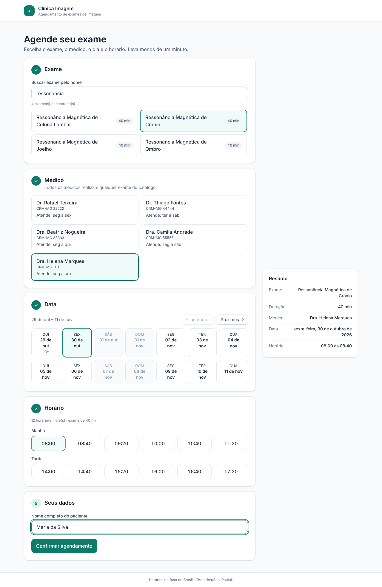
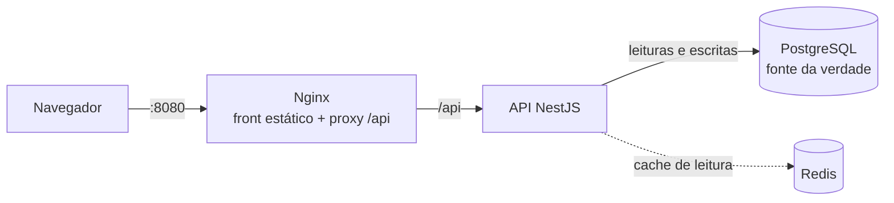
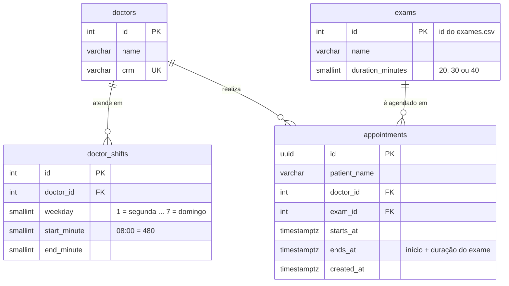
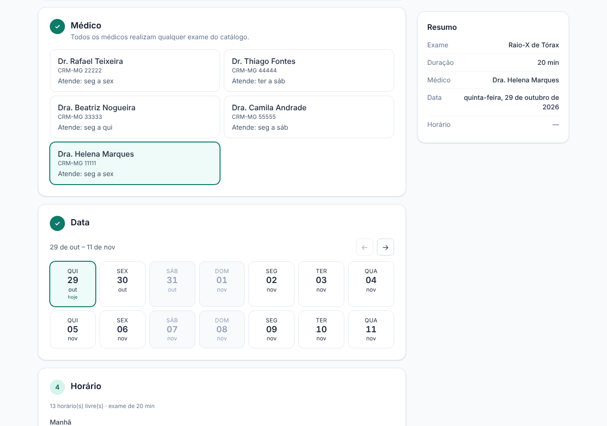
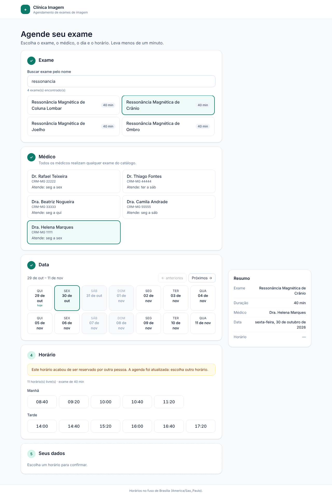

# Agendamento de Exames de Imagem

Aplicação full stack para agendar exames de imagem: o paciente **busca o exame**, escolhe o **médico**, vê os **horários livres** de uma data e **confirma o agendamento**. Tudo também está disponível pela API.

[](https://github.com/AndesondaCruz/agendamento-exames/actions/workflows/ci.yml)

| Camada | Tecnologias |
| --- | --- |
| Back-end | Node 22, NestJS 12, TypeScript, TypeORM, PostgreSQL 16, Redis 7 |
| Front-end | React 19, TypeScript (strict), Vite, Tailwind CSS 4, TanStack Query |
| Testes | Vitest, Supertest, Testing Library, axe-core (acessibilidade) |
| Infra | Docker, Docker Compose, Nginx, GitHub Actions, Dependabot |



---

## Sumário

- [Como rodar](#como-rodar)
- [Como testar](#como-testar)
- [API](#api)
- [Arquitetura](#arquitetura)
- [Decisões técnicas](#decisões-técnicas)
- [Premissas](#premissas)
- [O que ficou de fora](#o-que-ficou-de-fora-e-próximos-passos)
- [Fluxo de trabalho](#fluxo-de-trabalho)

---

## Como rodar

### Opção 1: Docker (recomendado, um comando)

Pré-requisito: Docker com Compose v2. As portas `8080`, `3000`, `5432` e `6379` precisam estar livres.

```bash
git clone https://github.com/AndesondaCruz/agendamento-exames.git
cd agendamento-exames
docker compose up --build --wait
```

| O quê | Onde |
| --- | --- |
| Aplicação (front) | http://localhost:8080 |
| API | http://localhost:3000/api |
| Documentação da API (Swagger) | http://localhost:3000/api/docs |

O container da API aplica as migrations e carrega o catálogo (30 exames e 5 médicos) sozinho ao subir. Para parar: `docker compose down` (acrescente `--volumes` para apagar também os dados).

### Opção 2: desenvolvimento local (com hot reload)

Pré-requisitos: **Node 22** (há um `.nvmrc`; com nvm, rode `nvm use`) e **npm 11** (`npm install -g npm@11`; o lockfile usa recursos do npm 11).

```bash
# 1. Banco e cache (só eles, via Docker)
docker compose up -d --wait postgres redis

# 2. API: http://localhost:3000/api
cd backend
cp .env.example .env
npm ci
npm run db:setup        # migrations + catálogo
npm run start:dev

# 3. Front (em outro terminal): http://localhost:5173
cd frontend
npm ci
npm run dev
```

Em desenvolvimento o Vite repassa `/api` para `localhost:3000`, então o front não precisa de configuração.

---

## Como testar

| Comando (dentro da pasta) | O que roda | Quantidade |
| --- | --- | --- |
| `backend`: `npm test` | Unitários: regra de horários, calendário/fuso, parser do CSV, cache | 59 testes |
| `backend`: `npm run test:e2e` | API completa via HTTP contra **Postgres e Redis reais** | 61 testes |
| `frontend`: `npm test` | Reducer, regras e fluxo completo da página (Testing Library) | 36 testes |

Os testes e2e usam um banco separado (`agendamento_test`, criado automaticamente pelo Docker na primeira subida) e se recusam a rodar em qualquer banco cujo nome não termine em `_test`. Precisam de `docker compose up -d --wait postgres redis`.

> Se o volume do Postgres já existia antes do script de criação do banco de teste, crie-o uma vez com:
> `docker exec agendamento-db createdb -U app agendamento_test`

**O que os testes garantem**, entre outros:

- a grade de horários do enunciado (turnos, durações de 20/30/40 min, horários ocupados, "agora");
- **20 requisições simultâneas para o mesmo horário: exatamente 1 sucesso e 19 conflitos (409)**;
- todas as validações e códigos de erro (400, 404, 409, 422);
- o cache: HIT/MISS, invalidação após agendar e a API funcionando **com o Redis fora do ar**;
- a documentação Swagger lista os erros que cada endpoint realmente devolve;
- o fluxo do front de ponta a ponta, incluindo o tratamento de horário ocupado por outra pessoa.

No CI, além disso, rodam formatação (Prettier), lint (oxlint), checagem de tipos, build, auditoria de dependências e um **smoke test do ambiente Docker completo** (front → Nginx → API → Postgres e Redis).

---

## API

Base: `http://localhost:3000/api`. Documentação interativa em `/api/docs`. Há uma coleção pronta em [`docs/api.http`](docs/api.http) (extensão REST Client do VS Code ou IDEs JetBrains).

| Método | Rota | Descrição |
| --- | --- | --- |
| `GET` | `/exams?search=resson` | Busca exames pelo nome (ignora maiúsculas e acentos) |
| `GET` | `/doctors` | Médicos com seus turnos semanais |
| `GET` | `/doctors/:doctorId/availability?examId=7&date=2026-11-16` | Horários livres do médico para o exame na data |
| `POST` | `/appointments` | Cria um agendamento |
| `GET` | `/appointments/:id` | Consulta um agendamento |
| `GET` | `/health` | Saúde da API, do banco e do cache |

### Exemplos com curl

> Use uma data futura. `2026-11-16` é uma segunda-feira, dia em que a Dra. Helena (id 1) atende.

```bash
# Buscar exames
curl "http://localhost:3000/api/exams?search=resson"

# Horários livres: Dra. Helena, Ultrassonografia Abdominal Total (40 min)
curl "http://localhost:3000/api/doctors/1/availability?examId=7&date=2026-11-16"

# Agendar
curl -X POST http://localhost:3000/api/appointments \
  -H "Content-Type: application/json" \
  -d '{"patientName":"Maria da Silva","examId":7,"doctorId":1,"startsAt":"2026-11-16T08:00:00-03:00"}'
```

Resposta da disponibilidade (resumida):

```json
{
  "date": "2026-11-16",
  "timezone": "America/Sao_Paulo",
  "doctor": { "id": 1, "name": "Dra. Helena Marques" },
  "exam": { "id": 7, "name": "Ultrassonografia Abdominal Total", "durationMinutes": 40 },
  "slots": [
    { "time": "08:00", "startsAt": "2026-11-16T08:00:00.000-03:00", "endsAt": "2026-11-16T08:40:00.000-03:00" },
    { "time": "08:40", "startsAt": "2026-11-16T08:40:00.000-03:00", "endsAt": "2026-11-16T09:20:00.000-03:00" }
  ],
  "unavailableReason": null
}
```

Data passada, dia sem atendimento ou agenda cheia **não são erro**: a resposta é `200` com `slots: []` e o motivo em `unavailableReason` (`PAST_DATE`, `NOT_WORKING_DAY`, `NO_AVAILABLE_SLOTS`). O front usa esse motivo para mostrar uma mensagem específica.

### Erros

Todo erro segue o mesmo formato, com um `code` estável (o cliente decide pelo `code`, não pelo texto):

```json
{
  "statusCode": 409,
  "code": "SLOT_UNAVAILABLE",
  "message": "Este horário não está mais disponível para este médico. Escolha outro.",
  "path": "/api/appointments",
  "timestamp": "2026-10-30T02:44:35.697Z"
}
```

| HTTP | `code` | Quando |
| --- | --- | --- |
| 400 | `VALIDATION_ERROR` | Corpo ou parâmetros inválidos; `details` lista cada campo e o motivo |
| 400 | `INVALID_DATE` | Data inexistente (ex.: `2026-02-30`) |
| 404 | `EXAM_NOT_FOUND`, `DOCTOR_NOT_FOUND`, `NOT_FOUND` | Recurso inexistente |
| 409 | `SLOT_UNAVAILABLE` | O horário foi ocupado, inclusive por uma requisição simultânea |
| 422 | `SLOT_IN_PAST` | Início no passado |
| 422 | `OUTSIDE_WORKING_HOURS` | O médico não atende ou o exame não cabe inteiro no turno |
| 422 | `SLOT_NOT_ON_GRID` | Horário fora da grade do exame (a mensagem lista os horários válidos) |
| 500 | `INTERNAL_ERROR` | Erro inesperado (detalhes só no log, nunca na resposta) |

A separação entre **422** e **409** é intencional: 422 é uma requisição que nunca seria válida; 409 é um conflito de estado, e tentar outro horário resolve.

---

## Arquitetura



### Estrutura

```
.
├── backend/                  API NestJS
│   ├── data/                 exames.csv e medicos.md (dados do enunciado)
│   ├── src/
│   │   ├── appointments/     agendamento e disponibilidade
│   │   │   └── domain/       regra de horários (função pura, sem framework)
│   │   ├── exams/  doctors/  catálogo
│   │   ├── common/           erros, validação, tempo/fuso, cache
│   │   ├── database/         migrations e seed
│   │   └── health/
│   └── test/e2e/             testes contra Postgres e Redis reais
├── frontend/                 React + Vite
│   └── src/
│       ├── api/              cliente HTTP, tipos e hooks (TanStack Query)
│       ├── features/booking/ fluxo de agendamento (página, reducer, componentes)
│       ├── components/       componentes genéricos (estados de loading/erro/vazio)
│       └── lib/              datas no fuso da clínica, mensagens de erro
├── docker-compose.yml        Postgres + Redis + API + front
└── .github/                  CI, Dependabot e template de PR
```

### Modelo de dados



Turnos são guardados em **minutos do dia** (`08:00` = 480): a geração de horários vira aritmética simples, sem depender de datas nem de fuso.

---

## Decisões técnicas

### 1. Concorrência garantida pelo banco, não pelo código

A regra "um médico não pode ter dois exames ao mesmo tempo" é uma **exclusion constraint** do PostgreSQL:

```sql
EXCLUDE USING gist (doctor_id WITH =, tstzrange(starts_at, ends_at, '[)') WITH &&)
```

"Não podem existir duas linhas com o mesmo médico **e** intervalos que se sobrepõem." Se duas requisições chegam juntas, o próprio Postgres aceita uma e rejeita a outra (erro `23P01`, que a API traduz para **409**).

Por que não "consultar antes de inserir": entre o `SELECT` e o `INSERT` outra requisição pode ocupar o horário (*race condition*). Um lock na aplicação não funcionaria com várias instâncias da API. A constraint é atômica, vale para qualquer cliente (inclusive SQL manual) e cobre **sobreposição parcial** entre exames de durações diferentes, não só o mesmo horário de início. O teste de concorrência dispara 20 requisições simultâneas e confirma 1 sucesso e 19 conflitos.

### 2. Regra de negócio isolada e testada primeiro

A geração de horários é uma **função pura** (`appointments/domain/slot-generator.ts`): recebe turnos, duração, horários ocupados e "agora", e devolve os inícios possíveis. Sem banco, sem Nest, sem datas. Foi escrita com TDD a partir dos exemplos do enunciado. A mesma função valida o `POST`: a API recusa horários fora da grade mesmo que o front nunca os ofereça.

### 3. Fuso horário explícito

- Os turnos valem no fuso da clínica (`America/Sao_Paulo`, configurável em `CLINIC_TIMEZONE`).
- O banco guarda `timestamptz` (instante absoluto, em UTC).
- A API responde com o offset local (`2026-11-16T08:00:00.000-03:00`).
- O `POST` **exige** o offset em `startsAt`: `08:00` sem fuso é ambíguo, então a API recusa em vez de adivinhar.
- O "agora" vem de um `Clock` injetável. Nos testes ele é fixo, então eles dão o mesmo resultado hoje, daqui a um ano e no CI.

### 4. Cache de leitura com Redis

| Leitura | Validade | Invalidação |
| --- | --- | --- |
| Busca de exames, lista de médicos | 1 h | a cada inicialização da API (o catálogo só muda no deploy) |
| Disponibilidade | 5 min | **imediata**, a cada agendamento daquele médico naquele dia |
| Disponibilidade de hoje | não usa cache | depende do relógio |

- **O cache nunca decide uma escrita.** O agendamento vai sempre ao Postgres. No pior caso, o cache mostra um horário que acabou de ser ocupado, e o banco responde 409.
- **Invalidação por versão** (*generational keys*): cada médico + dia tem um contador que faz parte da chave. Agendar sobe o contador, e as chaves antigas ficam inalcançáveis numa operação atômica. Isso também evita a corrida clássica de "apagar a chave", em que uma leitura lenta regrava o dado velho logo depois.
- **Degradação graciosa**: com o Redis fora, a API segue pelo banco, sem erro e sem espera (os comandos falham na hora, sem fila). O `/api/health` informa o estado do cache, mas não derruba a API por causa dele.
- Sem `REDIS_URL`, o cache fica em memória: a aplicação funciona do mesmo jeito.
- Header `X-Cache: HIT | MISS | BYPASS` em cada resposta cacheável.

Com 30 exames e 5 médicos o Postgres já responde em milissegundos. O cache está aqui para mostrar como o sistema se comportaria com volume real, sem comprometer as regras de negócio.

### 5. Banco versionado e dados de entrada validados

- Schema só muda por **migration** versionada (`synchronize` desligado).
- O seed lê o `exames.csv` com validação de cada linha (tolera BOM e quebras de linha do Windows, aponta a linha com erro) e é **idempotente**: pode rodar várias vezes sem duplicar.
- Variáveis de ambiente são validadas no boot (zod): configuração errada impede a API de subir, com mensagem clara.

### 6. Validação e erros de ponta a ponta

- DTOs com `class-validator`; campos desconhecidos são **rejeitados** (`forbidNonWhitelisted`).
- A busca usa parâmetros no SQL (sem SQL injection) e escapa os curingas do `LIKE`.
- Um filtro global padroniza todas as respostas de erro; erros inesperados são logados com stack trace e devolvidos sem detalhes internos.
- Helmet (cabeçalhos de segurança) e CORS restrito à origem do front.

### 7. Front-end

- **TanStack Query** para estado do servidor (cache, loading, erro, refetch) e `useReducer` com reducer puro para o estado da tela. O reducer garante, por exemplo, que trocar o exame limpa o horário escolhido.
- Cada etapa trata **loading, erro e vazio**; a disponibilidade se atualiza sozinha a cada 60 s.
- **Conflito (409)**: o paciente volta para a escolha de horário com um aviso, a lista é recarregada e o nome digitado é preservado.
- Dias em que o médico não atende já aparecem desabilitados.
- **Acessibilidade**: inputs nativos (navegação por teclado e leitor de tela), foco gerenciado, contraste verificado. Auditoria com axe-core: 0 violações WCAG 2.1 AA.
- Busca com debounce de 300 ms; build de produção com cerca de 86 KB (gzip).

| Escolha da data | Horário ocupado por outra pessoa (409) | Celular |
| --- | --- | --- |
|  |  |  |

### 8. Docker e CI/CD

- Imagens multi-stage, rodando como usuário **não-root**, com healthcheck. O front é servido por Nginx sem privilégios, com cache longo para os arquivos com hash e proxy para a API.
- O Compose sobe cada serviço só quando as dependências estão saudáveis.
- O pipeline do GitHub Actions roda em todo PR. A `main` é protegida: só recebe código por PR com o CI verde.
- Dependabot abre PRs semanais de atualização. As atualizações *major* são avaliadas uma a uma: três delas foram recusadas porque o CI mostrou que quebrariam o projeto, e as de `@types/node` porque os tipos precisam acompanhar o Node usado em produção (22).

---

## Premissas

Pontos que o enunciado deixa em aberto e como foram decididos:

1. **Grade de horários**: começa no início de cada turno e avança em passos iguais à duração do exame. Turno 08:00–12:00 com exame de 40 min gera 08:00, 08:40, 09:20, 10:00, 10:40, 11:20. Um horário só é oferecido se o exame couber **inteiro** no turno.
2. **Sobreposição**: intervalos são fechados no início e abertos no fim (`[início, fim)`). Um exame que termina às 08:40 não conflita com outro que começa às 08:40.
3. **Horários ocupados** removem da grade os inícios cujo intervalo se sobrepõe a um agendamento existente, inclusive de outro exame com outra duração. A grade não é recalculada a partir do fim do agendamento existente.
4. **Hoje**: só aparecem horários com início a partir de agora. Datas passadas retornam lista vazia.
5. **Fuso**: todos os horários são da clínica (`America/Sao_Paulo`).
6. **Qualquer médico faz qualquer exame**, como diz o `medicos.md`.
7. **Turnos não cruzam a meia-noite** (vale para todos os médicos do enunciado).
8. **Nome do paciente**: de 3 a 120 caracteres, só letras (com acento), espaços, apóstrofo, hífen e ponto.
9. **Janela de agendamento**: o front oferece os próximos 60 dias. A API não impõe limite superior.

---

## O que ficou de fora (e próximos passos)

Fora do escopo do desafio, mas o que eu faria num sistema real:

- **Autenticação e cadastro de pacientes** (CPF, contato); hoje o agendamento guarda só o nome.
- **Cancelar e remarcar** agendamentos; uma área do paciente para consultá-los.
- **Administração** de médicos, turnos e exames (hoje vêm do seed), incluindo feriados e bloqueios de agenda.
- **Rate limiting** no `POST /appointments` e proteção contra abuso.
- **Observabilidade**: logs estruturados (JSON), métricas e tracing.
- **Teste de carga** (k6) para medir o ganho real do cache e o comportamento sob concorrência alta.
- **Banco com dois perfis de acesso**: um com privilégios para migrations e outro restrito para a API em execução.
- **Validação explícita do certificado TLS** do banco em produção.
- Migração para TypeScript 7 e Vitest 5 no back-end (recusadas por enquanto; o CI apontou incompatibilidades).

---

## Fluxo de trabalho

- **GitHub Flow**: cada funcionalidade numa branch, integrada por Pull Request com descrição, CI obrigatório e *merge commit* (o histórico mostra a evolução por etapas).
- **Conventional Commits** (`feat`, `fix`, `test`, `build`, `ci`, `docs`...), em commits pequenos e com um assunto só.
- Ordem de construção: banco e catálogo → regra de horários (TDD) → API de agendamento → CI → front → Docker → cache.

### Uso de IA

Usei a IA (Claude) como assitente de programação e mentor técnico durante o desafio: para discutir alternativas de arquitetura, revisar código, investigar erros e escrever testes. As decisões foram minhas, e todo o código foi revisado, executado e testado por mim antes de cada commit.
